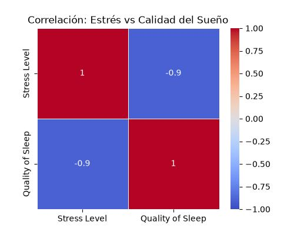
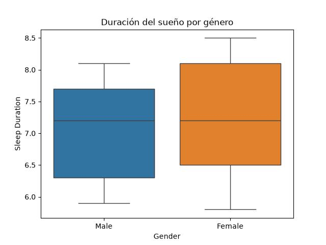
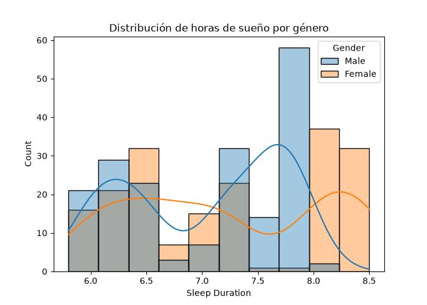
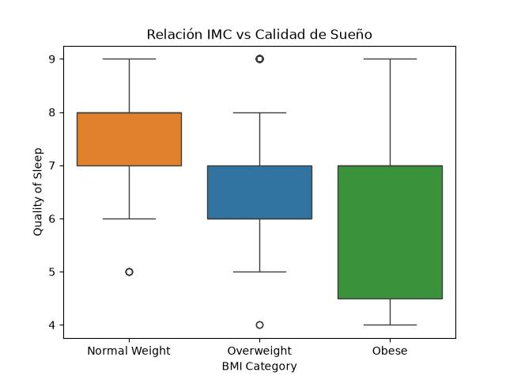
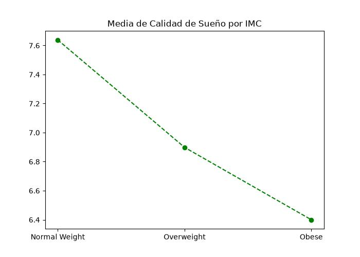
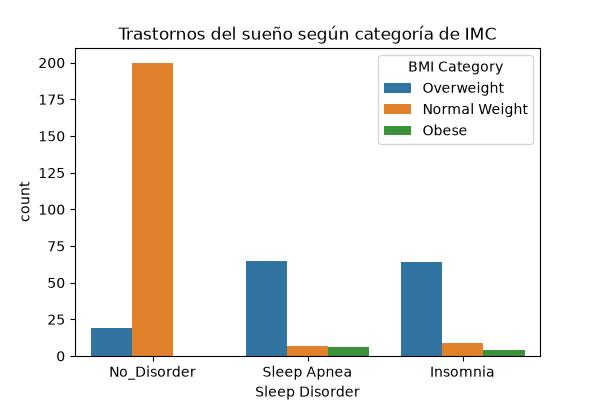
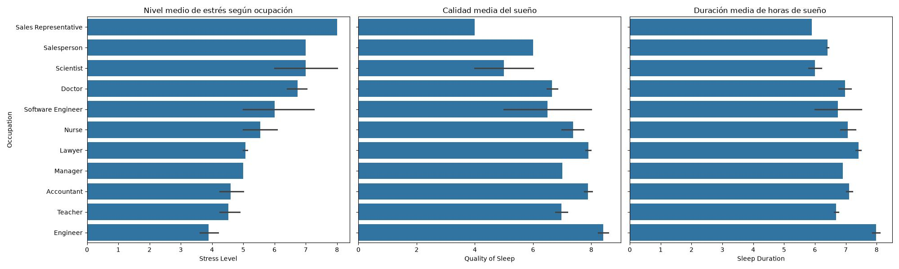
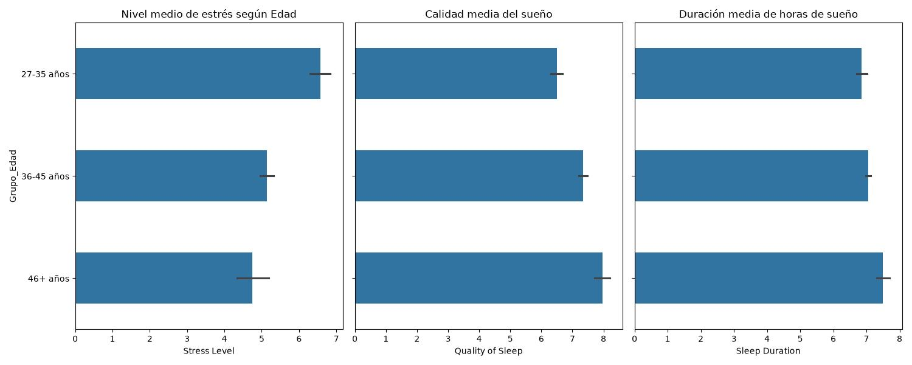
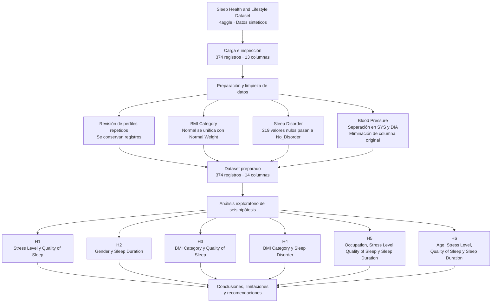

# Análisis del impacto de los factores de salud y estilo de vida en la calidad y duración del sueño


## Resumen ejecutivo

Este proyecto desarrolla un **Análisis Exploratorio de Datos (EDA)** sobre **374 registros** para estudiar la relación entre factores de salud y estilo de vida (estrés, género, peso corporal, trastornos del sueño, ocupación profesional y edad) y la calidad y duración del sueño.


## Principales hallazgos por hipótesis

Tras analizar los **374 registros** y contrastar las **6 hipótesis planteadas**, estos son los resultados clave del estudio:

- ✅ **H1 — El estrés presenta la mayor asociación negativa con la calidad del descanso (Confirmada):** Existe una fuerte correlación negativa (**-0.90**) entre el nivel de estrés y la calidad del sueño. Quienes reportan estrés bajo (3–5 puntos) alcanzan una calidad media de **7.67 a 8.97**, mientras que en el nivel máximo observado (8 puntos) desciende hasta **5.86**.

  


- ❌ **H2 — El género no marca diferencias prácticas relevantes en la duración (Descartada):** Aunque las mujeres promedian ligeramente más horas que los hombres (**7.23 h** vs. **7.04 h**, apenas ~11 minutos de diferencia) y presentan mayor dispersión (desviación estándar: **0.88** vs. **0.69**), ambos grupos comparten exactamente la misma mediana (**7.20 h**) y sus distribuciones se solapan ampliamente.

  
  


- ✅ **H3 — El exceso de peso se asocia con un deterioro de la calidad del sueño (Confirmada):** La puntuación media de calidad del descanso desciende progresivamente conforme aumenta la categoría de IMC: **7.64** en peso normal, **6.90** en sobrepeso y **6.40** en obesidad.

  
  


- ✅ **H4 — Fuerte asociación entre IMC y trastornos del sueño en ambas direcciones (Confirmada):**
  - *De trastorno a IMC:* Aproximadamente 9 de cada 10 personas con insomnio (**88.3%**) o apnea del sueño (**91.0%**) presentan sobrepeso u obesidad, frente a solo el **8.7%** en personas sin trastornos.
  - *De IMC a trastorno:* El **87.1%** de los casos con sobrepeso y el **100%** de los registros con obesidad presentan algún trastorno diagnosticado, mientras que el **92.6%** de quienes tienen peso normal duermen sin patologías.

  


- ✅ **H5 — El equilibrio estrés-descanso varía según la ocupación (Confirmada):** Perfiles de alta exigencia como *Salesperson* (estrés **7.00**; sueño **6.40 h**) y *Doctor* (estrés **6.73**; sueño **6.97 h**) muestran un escenario más desfavorable frente a roles como *Engineer* (estrés **3.89**; sueño **7.99 h**) o *Accountant* (estrés **4.59**; sueño **7.11 h**).

  


- ✅ **H6 — Los adultos jóvenes soportan mayor estrés y peor descanso (Confirmada):** El tramo de **27 a 35 años** concentra el peor escenario (estrés medio de **6.57**, calidad de **6.50** y **6.85 h** de sueño). A partir de los **46+ años**, el estrés desciende a **4.75** y el descanso mejora hasta las **7.50 h** (calidad media de **7.96**).

  


## Tabla de contenidos

- [Resumen ejecutivo](#resumen-ejecutivo)
- [Principales hallazgos por hipótesis](#principales-hallazgos-por-hipótesis)
- [Descripción del proyecto](#descripción-del-proyecto)
- [Objetivos](#objetivos)
- [Conjunto de datos](#conjunto-de-datos)
- [Hipótesis del estudio](#hipótesis-del-estudio)
- [Estructura del repositorio](#estructura-del-repositorio)
- [Flujo del análisis](#flujo-del-análisis)
- [Preparación y limpieza de datos](#preparación-y-limpieza-de-datos)
- [Resultados detallados por hipótesis](#resultados-detallados-por-hipótesis)
- [Conclusiones](#conclusiones)
- [Limitaciones, recomendaciones y líneas futuras](#limitaciones-recomendaciones-y-líneas-futuras)
- [Fuentes de información y licencia](#fuentes-de-información-y-licencia)

## Descripción del proyecto

El presente estudio analiza datos sintéticos creados con fines ilustrativos, centrándose en cómo se relacionan factores como el nivel de estrés, el género, el peso corporal, los trastornos del sueño, la ocupación profesional y la edad con la duración y calidad del sueño.

## Objetivos

### Objetivo general
Analizar mediante técnicas exploratorias cómo se relacionan distintos factores cotidianos (estrés, peso corporal, género, edad, ocupación profesional y trastornos del sueño) con las horas y la calidad del descanso.

### Objetivos específicos
1. Evaluar si niveles altos de estrés se asocian con una menor calidad del sueño.
2. Identificar si existen diferencias prácticas relevantes en la duración media del sueño entre hombres y mujeres.
3. Comparar la calidad del sueño entre personas con peso normal, sobrepeso y obesidad.
4. Analizar la asociación entre categorías de IMC y trastornos del sueño en ambas direcciones de análisis.
5. Comparar los niveles de estrés, duración y calidad del sueño entre distintas ocupaciones profesionales.
6. Examinar si los grupos más jóvenes presentan mayores niveles de estrés y menor duración y calidad del descanso.

## Conjunto de datos

El conjunto de datos utilizado es *Sleep Health and Lifestyle Dataset*, procedente de Kaggle. Su estructura original contiene **374 registros y 13 columnas**.

| Variable | Tipo | Descripción |
| :--- | :--- | :--- |
| "Person ID" | Numérica | Identificador único de cada persona. |
| "Gender" | Categórica | Género ("Male", "Female"). |
| "Age" | Numérica | Edad en años. |
| "Occupation" | Categórica | Ocupación profesional. |
| "Sleep Duration" | Numérica | Duración diaria del sueño en horas. |
| "Quality of Sleep" | Numérica | Calidad subjetiva del sueño en escala de 1 a 10. |
| "Physical Activity Level" | Numérica | Minutos diarios de actividad física. |
| "Stress Level" | Numérica | Nivel subjetivo de estrés en escala de 1 a 10. |
| "BMI Category" | Categórica | Categoría de índice de masa corporal ("Normal Weight", "Overweight", "Obese"). |
| "Blood Pressure" | Texto | Presión arterial sistólica y diastólica. |
| "Heart Rate" | Numérica | Frecuencia cardíaca en reposo. |
| "Daily Steps" | Numérica | Número de pasos diarios. |
| "Sleep Disorder" | Categórica | Presencia o ausencia de trastornos del sueño ("No_Disorder", "Insomnia", "Sleep Apnea"). |

## Hipótesis del estudio

| Hipótesis | Planteamiento | Variables | Resultado |
| :--- | :--- | :--- | :---: |
| **H1** | A mayor nivel de estrés, menor calidad del sueño. | "Stress Level", "Quality of Sleep" | Confirmada |
| **H2** | Hombres y mujeres tienen una duración media de sueño diferente. | "Gender", "Sleep Duration" | Descartada |
| **H3** | Personas con sobrepeso u obesidad tienen peor calidad de sueño que personas con peso normal. | "BMI Category", "Quality of Sleep" | Confirmada |
| **H4** | Personas con trastorno del sueño diagnosticado presentan mayor proporción de sobrepeso u obesidad, y viceversa. | "BMI Category", "Sleep Disorder" | Confirmada |
| **H5** | La ocupación profesional se asocia con variaciones en los niveles de estrés, duración y calidad del sueño. | "Occupation", "Stress Level", "Quality of Sleep", "Sleep Duration" | Confirmada |
| **H6** | A menor edad incrementan los niveles de estrés y disminuyen la duración y calidad del sueño. | "Age", "Stress Level", "Quality of Sleep", "Sleep Duration" | Confirmada |

## Estructura del repositorio

```text
EDA-ANALISIS-DEL-SUENO/
├── cuaderno/
│   ├── 01_contexto_objetivos_y_fuentes.ipynb
│   ├── 02_planteamiento_hipotesis_y_alcance.ipynb
│   ├── 03_carga_y_limpieza_datos.ipynb
│   ├── 04_analisis_y_contraste_hipotesis.ipynb
│   ├── 05_conclusiones_y_recomendaciones.ipynb
│   └── memoria.ipynb
├── datos/
├── imagen/
├── src/
│   ├── __init__.py
│   ├── analisis_hipotesis.py
│   ├── carga_inspeccion.py
│   ├── configuracion.py
│   ├── graficos.py
│   └── limpieza.py
├── LICENSE
├── main.py
├── presentacion.pptx
└── README.md
```

### Organización de los cuadernos
1. "01_contexto_objetivos_y_fuentes.ipynb": contexto del estudio, objetivos y fuentes de información.
2. "02_planteamiento_hipotesis_y_alcance.ipynb": planteamiento de hipótesis y delimitación del proyecto.
3. "03_carga_y_limpieza_datos.ipynb": carga, inspección y preparación de datos.
4. "04_analisis_y_contraste_hipotesis.ipynb": exploración de variables y contraste de hipótesis.
5. "05_conclusiones_y_recomendaciones.ipynb": conclusiones, limitaciones y recomendaciones.

> La memoria completa del estudio se encuentra en "cuaderno/memoria.ipynb".

### Herramientas utilizadas
* **Lenguaje:** Python
* **Entorno:** Jupyter Notebook
* **Análisis y cálculo:** Pandas, NumPy
* **Visualización:** Matplotlib, Seaborn

## Flujo del análisis



*Las flechas representan el recorrido metodológico del trabajo, no relaciones de causa y efecto entre variables.*

## Preparación y limpieza de datos

### Revisión de registros repetidos
Al excluir "Person ID", se identificaron **242 filas repetidas**, quedando **132 perfiles únicos**. Se decidió conservar estos registros al tratarse de datos sintéticos donde los perfiles repetidos representan patrones frecuentes, teniendo en cuenta esta decisión al interpretar correlaciones.

### Normalización de categorías de IMC
Se unificaron "Normal" y "Normal Weight" bajo la denominación "Normal Weight":

| Categoría | Registros |
| :--- | ---: |
| "Normal Weight" | 216 |
| "Overweight" | 148 |
| "Obese" | 10 |

### Tratamiento de valores nulos
La columna "Sleep Disorder" contenía **219 valores nulos**. Según la interpretación documentada en el estudio, estos registros corresponden a personas sin trastorno del sueño, por lo que se sustituyeron por "No_Disorder".

### Transformación de presión arterial
La variable "Blood Pressure" se dividió en dos variables numéricas independientes:
* "SYS": presión sistólica.
* "DIA": presión diastólica.

Se comprobó que no existían registros con presión sistólica menor o igual que la diastólica y posteriormente se eliminó la columna original.

## Resultados detallados por hipótesis

### H1. Estrés y calidad del sueño
* Correlación negativa aproximada de **-0.90** entre nivel de estrés y calidad del sueño.
* Niveles de estrés de **3 a 5 puntos** presentan calidades medias de entre **7.67 y 8.97**.
* En el nivel de estrés de **8 puntos**, la calidad media desciende hasta **5.86**.
* **Conclusión:** Hipótesis confirmada.

### H2. Género y duración del sueño
* Las mujeres presentan una duración media de **7.23 horas**, frente a **7.04 horas** en hombres (diferencia aproximada de 11 minutos), con desviación estándar de **0.88** vs. **0.69**.
* Ambos grupos comparten exactamente la misma mediana (**7.20 horas**) y distribuciones ampliamente solapadas.
* **Conclusión:** Hipótesis descartada en la práctica al no observar diferencias relevantes en horas de descanso.

### H3. Peso corporal y calidad del sueño
La calidad media del sueño disminuye entre las categorías analizadas *(interpretando "Obese" con cautela por su escasa representación de 10 registros)*:

| Categoría de IMC | Calidad media del sueño |
| :--- | ---: |
| "Normal Weight" | 7.64 |
| "Overweight" | 6.90 |
| "Obese" | 6.40 |

* **Conclusión:** Hipótesis confirmada.

### H4. IMC y trastornos del sueño
Se identifica una fuerte asociación en ambas direcciones de análisis sin concluir causalidad:
* El **88.3%** de las personas con "Insomnia" y el **91.0%** con "Sleep Apnea" presentan sobrepeso u obesidad (frente a solo el **8.7%** en quienes no tienen trastornos).
* El **87.1%** de las personas en categoría "Overweight" presenta "Insomnia" o "Sleep Apnea".
* Los **10 registros** de categoría "Obese" (**100%**) presentan algún trastorno del sueño.
* El **92.6%** de las personas en categoría "Normal Weight" no presenta trastornos del sueño.
* **Conclusión:** Hipótesis confirmada.

### H5. Ocupación profesional, estrés y descanso
Se observan diferencias notables entre las ocupaciones analizadas *(las profesiones con pocos registros se interpretan con especial cautela)*:

| Ocupación | Estrés medio | Duración media del sueño |
| :--- | ---: | ---: |
| "Doctor" | 6.73 | 6.97 h |
| "Salesperson" | 7.00 | 6.40 h |
| "Engineer" | 3.89 | 7.99 h |
| "Accountant" | 4.59 | 7.11 h |

* **Conclusión:** Hipótesis confirmada.

### H6. Edad, estrés y descanso
* **Grupo de 27 a 35 años:** Estrés medio de **6.57** | Calidad media de **6.50** | Duración media de **6.85 horas**.
* **Grupo de 46 años o más:** Estrés medio de **4.75** | Calidad media de **7.96** | Duración media de **7.50 horas**.
* **Conclusión:** Hipótesis confirmada.

## Conclusiones

Tras analizar los **374 registros** y comprobar las **6 hipótesis** del estudio, se extraen las siguientes conclusiones:

La salud del sueño no depende del género, sino de una combinación de factores vinculados al estrés, el trabajo, la edad y el peso corporal.

En particular, el estrés es el factor que más perjudica el descanso, afectando especialmente a los adultos jóvenes y a profesiones de mayor presión (como el ámbito sanitario y comercial). En cambio, en edades más avanzadas y en ocupaciones más estables, el estrés disminuye y el sueño mejora de forma clara. A esto se suma el exceso de peso, que también se relaciona estrechamente con un peor descanso y con una mayor presencia de trastornos del sueño.

En definitiva, dormir mal no es una cuestión de género, sino principalmente de estrés, carga laboral y sobrepeso; factores sobre los que sí es posible actuar mediante medidas dirigidas a los grupos más vulnerables.

## Limitaciones, recomendaciones y líneas futuras

### Limitaciones del estudio
* Datos sintéticos con finalidad ilustrativa.
* La presencia de perfiles repetidos puede intensificar las correlaciones frente a una muestra poblacional real.
* La categoría "Obese" cuenta únicamente con 10 registros.
* Algunas ocupaciones tienen representación reducida ("Manager": 1, "Sales Representative": 2, "Scientist": 4, "Software Engineer": 4).
* Al tratarse de un estudio observacional transversal, las asociaciones encontradas (como entre IMC y trastornos del sueño) no permiten establecer causalidad directa.

### Recomendaciones recogidas en el estudio
* Priorizar programas de higiene del sueño y gestión del estrés dirigidos al segmento adulto joven de **27 a 35 años** y a colectivos laborales de alto estrés (personal sanitario y equipos comerciales).
* Integrar el seguimiento del peso corporal en protocolos de detección temprana de apnea del sueño e insomnio.
* Diseñar campañas y medidas de descanso transversales sin segmentación por género.

### Alcance y líneas futuras
Para una siguiente fase se plantea ampliar el análisis incorporando:
* **Actividad física:** "Physical Activity Level" y "Daily Steps".
* **Indicadores cardiovasculares:** presión arterial ("SYS" y "DIA") y "Heart Rate".

## Fuentes de información y licencia

### Fuentes de información
Referencias utilizadas para contextualizar el estudio y fundamentar las hipótesis (recogidas en "cuaderno/memoria.ipynb"):
* Sociedad Española de Neurología (SEN): *Los problemas del sueño amenazan la salud y la calidad de vida de hasta el 45 % de la población mundial*.
* Hospital Quirónsalud: *La falta de sueño altera la salud y la calidad de vida*.
* Universidad de La Rioja (Dialnet): *Análisis de los determinantes de la calidad de sueño en población española*.
* Universidad de Las Palmas de Gran Canaria: *Estudio sobre la necesidad del descanso y el sueño*.

**Fuente de datos:** Kaggle, *Sleep Health and Lifestyle Dataset*.

### Licencia
Consulta el archivo "LICENSE" incluido en el repositorio.